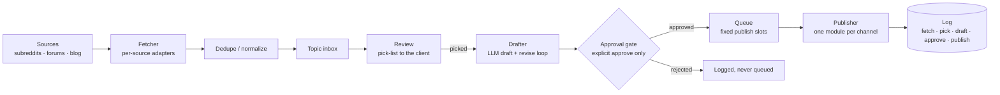

# Orchestrator Sample — fetch → review → approve → queue → publish

A small, dependency-free Python slice of the pattern we run in production:
sources are fetched and deduped, drafts wait in a review inbox, **nothing
publishes without an explicit approval**, approved items enter a scheduled
queue, and every step is logged so "did it go out?" is always answerable.

Full starter (this pattern, complete): https://theworkflowwire.gumroad.com/l/yunnet — $49 one-time, single-business license.

This is a code-quality sample for the Victory Node build shop. It is the
skeleton of a LinkedIn-first social-media orchestrator: swap the demo
source adapter for Firecrawl/Reddit/forum fetchers and the demo publisher
for a real channel publisher — each stage is one small module.

## Architecture



The approval gate is **structural**: `Queue.enqueue()` refuses any item
whose status is not `APPROVED`, and the only way to reach `APPROVED` is
`ReviewInbox.approve()`. There is no setting that bypasses it.

## Layout

| Module | Job |
|---|---|
| `src/orchestrator/models.py` | `Topic`, `Draft`, `QueuedPost`, status enum |
| `src/orchestrator/fetcher.py` | Source adapters + dedupe/normalize |
| `src/orchestrator/review.py` | Topic inbox, pick-list, draft/revise loop, approval gate |
| `src/orchestrator/queue.py` | Slot calendar; enqueue refuses unapproved items |
| `src/orchestrator/publisher.py` | Publisher protocol + demo publisher |
| `src/orchestrator/log.py` | Append-only JSON-lines event log |

## Run it

```bash
python3 -m unittest discover -s tests -v   # stdlib only, no installs
python3 -m orchestrator.demo               # end-to-end demo (PYTHONPATH=src)
```

CI: GitHub Actions runs the test suite on every push (`.github/workflows/ci.yml`).
Local checks mirror CI via the pre-commit config (`.pre-commit-config.yaml`).

## Design rules (how we build client work)

- Small modules, one job each; adding a channel = one new publisher module.
- Secrets in environment variables, never in code.
- Every state change is logged; the log is the receipt.
- Estimates and scope are written down before builds start.
